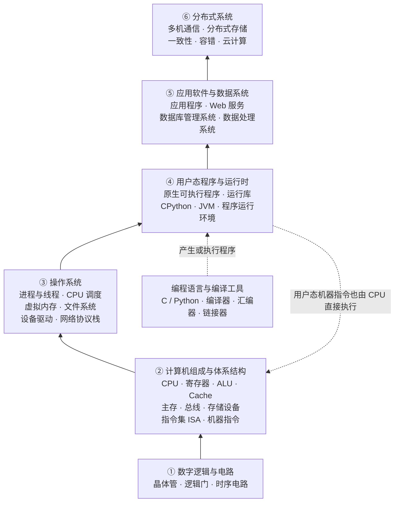

# 计算机学习笔记

从具体问题出发，记录概念、推导、可复现实验和原始参考资料。

## 计算机系统

### 知识架构总览

这张图按**抽象层次与主要依赖关系**组织计算机系统知识。箭头不表示程序执行时必须依次经过的步骤；编译工具与网络等主题会跨越不同层级。

其中，分布式系统是在多个计算机系统之上构建的协作机制，不是每台计算机都必须经过的一层；网络涉及硬件、操作系统和应用等多个层次。这是一张用于整理知识的概念图，不是严格的软硬件执行栈。

### 已整理的笔记

- [运行程序时，到底是谁在执行谁？](systems/how-python-runs.md)

对比 C 的预处理、编译、汇编、链接，与 CPython 的字节码解释执行；区分解释器与 CPU 的执行角色。配有 Mermaid 流程图及 C / Python 实验。

[配套实验](examples/program-execution/) · [实际验证结果](examples/program-execution/VERIFICATION.md)

## 阅读方式

在 GitHub 中打开 [文章 Markdown](systems/how-python-runs.md) 阅读正文。文中的流程图使用 Mermaid：它是可编辑的图表描述，GitHub 支持把相应代码块渲染成流程图。在本地阅读时，需要支持 Mermaid 的 Markdown 阅读器；普通文本编辑器会显示图表源码。

## 内容边界

文章说明适用的实现与环境，不把某个工具版本的表现当作所有平台的规定。实验记录只反映列明环境中实际执行过的检查，不冒充用户本人电脑上的结果。
