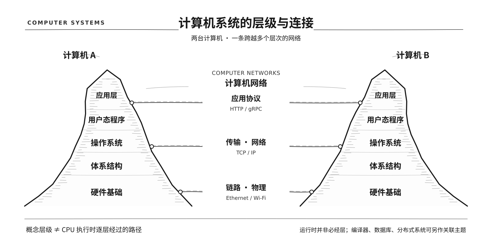

# 计算机系统学习笔记

从具体问题出发，整理计算机系统的基础原理、可复现实验与参考资料。

## 知识地图

这是一张 **知识结构图**，而不是 CPU 执行程序时的逐层调用图。山脊表示单机系统从硬件基础到软件应用的抽象关系；旁边的小路表示跨越多层的研究领域。

| 区域 | 主要内容 |
| --- | --- |
| **Digital Logic**（数字逻辑） | 逻辑门、组合电路、时序电路 |
| **Computer Architecture**（计算机体系结构） | CPU、指令集、寄存器、缓存、内存与 I/O |
| **Operating Systems**（操作系统） | 进程、线程、调度、虚拟内存、文件系统 |
| **Programs & Runtimes**（程序与运行时） | 可执行程序、运行库、CPython、JVM |
| **Applications**（应用） | 各种使用计算机能力的软件 |
| **Compilers & Tools**（编译与工具链） | 编译、汇编、链接与构建 |
| **Databases**（数据库） | 索引、查询、事务与存储 |
| **Computer Networks**（计算机网络） | 网络硬件、TCP/IP、Socket、HTTP |
| **Distributed Systems**（分布式系统） | 多机通信、一致性、复制、容错 |

图中的分布式系统是通过网络组织多台计算机的扩展方向，并不是每台计算机都必须经历的一层。数据库通常是运行在操作系统上的软件；编译器与网络则涉及多个抽象层次。**地图中的领域不代表每个都必须写一篇笔记。**

[查看原始矢量图（SVG）](assets/computer-systems-atlas.svg)

## 已整理的笔记

**[运行程序时，到底是谁在执行谁？](systems/how-python-runs.md)**

以 C 与 CPython 为例，解释源代码、汇编、机器码、字节码、编译器、解释器和 CPU 之间的关系。

[配套代码](examples/program-execution/) · [实验输出与验证记录](examples/program-execution/VERIFICATION.md)

---
笔记以可验证的技术资料与示例为基础；实验结果的适用环境会在文内注明。
