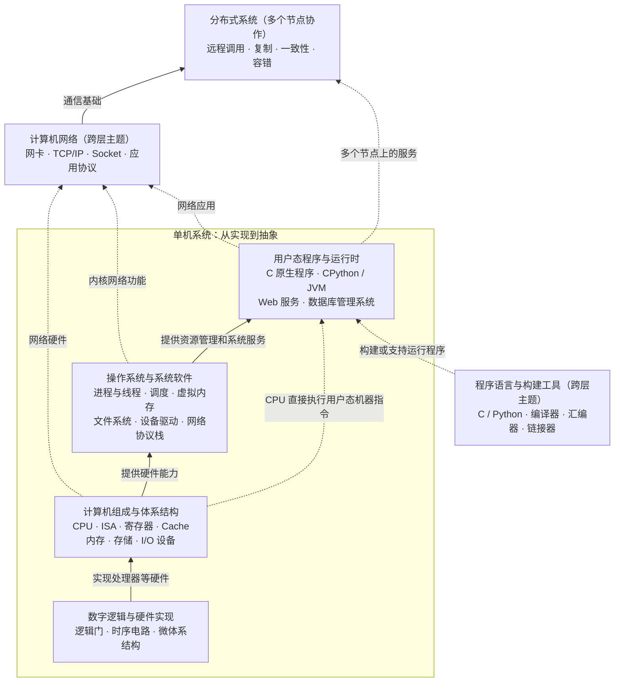

# 计算机学习笔记

从具体问题出发，记录概念、推导、可复现实验和原始参考资料。

## 计算机系统

### 知识架构总览

这是一张用于组织笔记的**系统抽象与依赖关系图**，不是程序执行时的逐层调用流程。主干展示一台计算机从硬件到软件的关系；侧面展示程序构建、计算机网络与多机协作。

**读图方式：**实线表示实现或主要支撑关系，虚线表示跨层联系。操作系统提供资源管理和系统服务，但普通用户态机器指令由 CPU 直接执行，并不需要内核逐条解释。网络跨越硬件、内核和应用；分布式系统依靠多台计算机与网络协作，**不是单机应用之上必经的第六层**。这张图只展示知识结构，不代表每个模块都必须有单独笔记。

概念参考：[《Computer Systems: A Programmer's Perspective》](https://csapp.cs.cmu.edu/) · [MIT 6.5840 Distributed Systems](https://pdos.lcs.mit.edu/6.824/index.html)

### 已整理的笔记

- [运行程序时，到底是谁在执行谁？](systems/how-python-runs.md)

对比 C 的预处理、编译、汇编、链接，与 CPython 的字节码解释执行；区分解释器与 CPU 的执行角色。配有 Mermaid 流程图及 C / Python 实验。

[配套实验](examples/program-execution/) · [实际验证结果](examples/program-execution/VERIFICATION.md)

## 阅读方式

在 GitHub 中打开 [文章 Markdown](systems/how-python-runs.md) 阅读正文。文中的流程图使用 Mermaid：它是可编辑的图表描述，GitHub 支持把相应代码块渲染成流程图。在本地阅读时，需要支持 Mermaid 的 Markdown 阅读器；普通文本编辑器会显示图表源码。

## 内容边界

文章说明适用的实现与环境，不把某个工具版本的表现当作所有平台的规定。实验记录只反映列明环境中实际执行过的检查，不冒充用户本人电脑上的结果。
