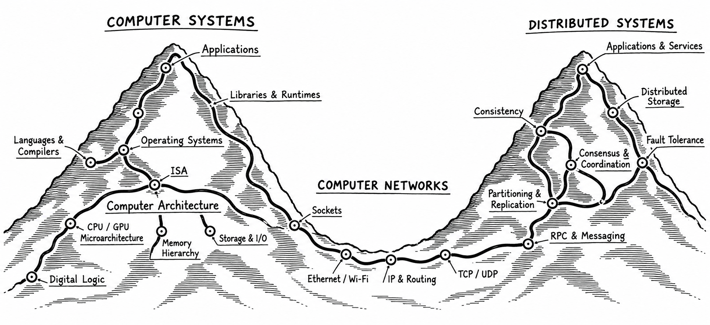

# 计算机系统学习笔记

从具体问题出发，整理计算机系统的基础原理、可复现实验与参考资料。

## 知识地图

这张图以两座山和中间的网络连接展示三个知识领域：左侧是从数字逻辑、计算机体系结构到操作系统和应用的计算机系统；中间是计算机网络；右侧是涵盖复制、一致性、共识与容错等主题的分布式系统。它不是 CPU 执行一段程序时必须依次经过的路径，也不代表每个领域都必须写一篇笔记。

| 区域 | 核心内容 |
| --- | --- |
| **硬件基础** | 数字逻辑、电路、存储与 I/O 设备 |
| **体系结构** | CPU、机器指令、ISA、寄存器和缓存 |
| **操作系统** | 进程、线程、调度、虚拟内存、文件系统、设备驱动和网络栈 |
| **用户态程序** | 原生程序、标准库与可选的语言运行时（如 CPython / JVM） |
| **应用层** | Web 服务、应用程序、数据库管理系统等 |
| **计算机网络（跨层）** | HTTP / gRPC；TCP / IP；以太网 / Wi-Fi |
| **关联领域** | 编译器与工具链、数据库原理、分布式系统、安全等；它们不构成单机必经的层级 |

普通用户态机器指令直接由 CPU 执行，操作系统并不逐条转发或解释。网络通信涉及多个层次，而语言运行时是否需要取决于具体的程序与实现。

[查看原图（PNG）](assets/computer-systems-landscape.png)

## 已整理的笔记

**[运行程序时，到底是谁在执行谁？](systems/how-python-runs/)**

以 C 与 CPython 为例，解释源代码、汇编、机器码、字节码、编译器、解释器和 CPU 之间的关系。

[实验 notebook：代码与 Linux 实际输出](systems/how-python-runs/experiments.ipynb)

---
笔记以可验证的技术资料与示例为基础；实验结果的适用环境会在文内注明。
