# 从计算机架构出发，理解操作系统、进程与线程

[上一篇](../01-how-python-runs/)讨论了代码怎样被转换，以及最终由谁执行。现在，我们把这些角色放回一台计算机中，先看它们各自在哪里，再看它们怎样配合。

## 1. 一台计算机，先分硬件与软件

**硬件提供执行与存储能力，软件规定怎样使用这些能力。** CPU 执行机器指令，内存保存执行中的代码和数据，硬盘、网卡、键盘等设备提供存储、通信和输入输出能力。



[图表源码（Mermaid）](architecture.mmd)

这张图先按硬件与软件分类。下面进一步看软件内部的分工，以及它们之间的调用关系。

## 2. 应用、库、Runtime 与内核，怎样分工？

| 概念 | 定义与具体职责 | 例子 |
| --- | --- | --- |
| 应用（Application） | 为用户完成具体任务的软件，组织这个任务的处理步骤。 | 文本编辑器决定何时读取文档、修改文字、保存文件。 |
| 程序库（Libraries） | 把可复用的功能封装成函数、类等接口，供其他代码调用。 | JSON 库提供解析函数，把 JSON 文本转换成程序里的数据。 |
| 语言运行时系统（Runtime System，简称 Runtime） | 语言实现中，在程序执行期间负责落实语言规则的那部分代码，例如按类型执行操作、管理对象、处理函数调用和异常。 | CPython 根据对象类型执行 Python 的 `+`，并管理 Python 对象的分配与回收。 |
| 内核（Kernel） | 操作系统中有权管理 CPU、内存和设备等资源的核心软件，向程序提供文件读写、内存映射等系统服务。 | 安排哪个线程使用 CPU、建立地址空间、处理文件读取请求。 |

### Runtime：把语言规则落实成执行动作

Python 规定两个整数相加得到整数，两个字符串相加得到拼接后的字符串。CPU 提供的是机器指令；**在 CPython 中，识别 Python 对象、选择对应操作并返回 Python 对象的工作，由 Runtime 的代码完成。**[Python：对象与类型](https://docs.python.org/3/reference/datamodel.html#objects-values-and-types)

例如，应用写了这个函数：

```python
def add(a, b):
    return a + b
```

执行 `add(2, 3)` 时，CPython 要完成几件事：

1. **进入函数。** 把实参对应到 `a`、`b`，建立并维护这次调用的执行状态。
2. **执行加法。** 按整数类型的规则计算，得到表示 `5` 的 Python 整数对象。换成 `add("hello", "world")`，则按字符串类型的规则完成拼接。
3. **返回结果并管理对象。** 把结果交给调用者，同时维护对象的引用及其生命周期，按对象回收机制处理可回收的对象。

应用只写了“把 `a` 和 `b` 相加”，上述处理由 CPython 中现成的代码承担。沿用上一篇的常规字节码解释执行路径，解释器读取字节码，执行对应的处理代码；对象管理等机制与它一起构成这里讨论的 Runtime。[Python：字节码](https://docs.python.org/3/glossary.html#term-bytecode) [Python：对象生命周期](https://docs.python.org/3/reference/datamodel.html#objects-values-and-types)

**Runtime 的职责范围取决于语言及其实现。** 例如，C 的普通整数加法通常在编译时就转换成机器指令；CPython 则在执行时处理 Python 对象及其操作。理解一个 Runtime，关键是看该语言实现把哪些工作留给了执行期间的配套代码。

### 它们的层级和调用关系

**用户态（User Mode）和内核态（Kernel Mode），是 CPU 执行代码时所处的两种权限模式。** 在本文讨论的普通桌面系统中：

- **用户态**：CPU 执行应用、程序库和语言 Runtime 的普通代码，硬件限制这些代码可以访问的资源和执行的操作。
- **内核态**：CPU 执行内核代码，允许执行管理内存、设备等资源所需的特权操作。

CPU 可以在这两种模式之间切换。例如，程序通过**系统调用（System Call）** 请求内核服务时，系统调用指令使 CPU 切换到内核态，并跳转到内核指定的入口。内核处理请求后，可以返回用户态，继续执行程序。因此，后文说“CPU 进入内核态”，指的就是 CPU 改变执行权限，并开始执行相应的内核代码。[OSTEP：执行权限与系统调用](https://pages.cs.wisc.edu/~remzi/OSTEP/cpu-mechanisms.pdf)

以 CPython 为例，可以把关系画成：

```text
用户态
  应用代码 ──调用──→ 程序库
       Python 编写的应用和库代码
                  ↓ 由 CPython 执行
  CPython Runtime：字节码执行、对象操作、对象内存管理等
       ↕ 也会调用 C 等语言编写的原生库
──────────────── 系统调用接口 ────────────────
内核态
  内核：调度线程、管理地址空间、处理文件与设备访问
─────────────────────────────────────────────
硬件
  CPU 执行机器指令；内存存放代码和数据；设备完成 I/O
```

这里有两种关系：**应用、库与 Runtime 之间是功能调用和执行依赖；用户态与内核态之间是权限边界。** 具体调用路径随任务而变化：Python 加法可以在用户态完成；读取文件时，相关代码会通过系统调用请求内核服务。应用、库、Runtime 和内核中的机器指令，最终都由 CPU 执行。

库强调“把功能封装起来，供代码调用”，Runtime 强调“承担语言执行机制”。同一份代码可以同时具有这两个属性：Runtime 可以封装成库，应用也可以调用库中的 Runtime 功能。

以内存为例，**内核管理地址空间和内存映射，CPython 在可用内存中分配并组织 Python 对象。** 创建一个小对象时，CPython 可以复用已经取得的内存；需要更多内存时，底层分配器再向操作系统申请。这样便能区分内核对系统资源的管理与 Runtime 对语言对象的管理。[Python：内存管理](https://docs.python.org/3/c-api/memory.html)

接下来把这些软件运行起来：内核用什么结构记录它们占有的资源，以及执行到了哪里？这就引出了进程与线程。

## 3. 进程与线程：哪些独立，哪些共享？

以一个简化的文本编辑器为例，比较两种运行结构：分别启动两个编辑器实例，让它们作为两个独立进程运行；在一个编辑器进程中，用两个线程分别处理输入和检查文档。这里讨论的是设定的结构，实际编辑器可以组合使用多个进程和多个线程。

### 两个进程：分别管理两次运行

假设两次启动使用同一份编辑器程序文件，每次都把文档读入自己的内存。程序文件相同，但两次运行的文档内容、打开的文件和执行进度需要分别管理。

```text
编辑器进程 A
├── 自己的地址空间与文档数据
└── 线程 A：自己的执行位置、寄存器状态和栈

编辑器进程 B
├── 自己的地址空间与文档数据
└── 线程 B：自己的执行位置、寄存器状态和栈
```

在 A 中输入一个字，修改的是 A 内存中的文档数据，不会自动改动 B 内存中的那一份。即使它们打开同一个磁盘文件，内存中的两份数据也不会自动保持一致；保存和重新读取文件是另外的操作。

操作系统内核用**进程（Process）** 组织一次运行的地址空间（Address Space）、资源与相关状态。普通进程通常拥有各自的地址空间；需要交换数据时，可以使用进程间通信，也可以明确建立共享内存。[Linux：进程与地址空间](https://man7.org/linux/man-pages/man2/fork.2.html)

这种独立体现为各自的地址空间与运行状态；两个进程仍可访问同一个文件，部分物理内存也可以共享。

### 同一进程中的两个线程：共享资源，分别推进工作

现在只看其中一个编辑器。它一边响应输入，一边在后台检查文档。两项工作可以访问同一份文档对象，却需要分别记录各自正在做什么：输入处理可能正在插入字符，检查工作可能正在分析另一段文字。

**线程（Thread）** 表示这样一条执行路线。同一进程中的线程共享地址空间及打开的文件等资源，各自保留执行位置、寄存器状态和栈。[Linux：线程的共享与独立属性](https://man7.org/linux/man-pages/man7/pthreads.7.html)

```text
一个编辑器进程
├── 共同访问的代码、文档数据和文件等资源
├── 输入线程：自己的执行位置、寄存器状态和栈
└── 检查线程：自己的执行位置、寄存器状态和栈
```

两个线程使用的是同一个文档对象，输入线程的修改作用于这份共同的数据。它们可以在不同的位置执行、调用不同的函数，所以仍然需要各自的执行状态和栈。各线程的栈也位于同一个进程的地址空间中。

### 把两种结构放在一起比较

| 比较对象 | 两个独立进程，各有一个线程 | 同一进程中的两个线程 |
| --- | --- | --- |
| 地址空间 | 通常各自拥有一个 | 共享同一个 |
| 内存中的文档数据 | 本例中各自保存一份，修改不会自动传给另一份 | 本例中共同访问同一份对象 |
| 执行位置与寄存器状态 | 各自的线程分别记录 | 两个线程分别记录 |
| 栈 | 各自线程使用各自的栈 | 各自使用各自的栈，但都在同一地址空间中 |
| 协作方式 | 通过通信，或明确建立共享内存等机制 | 可以直接访问共同数据，并协调访问时序 |

一个进程可以有一个或多个线程。上表中从左到右的变化，就是把两条执行路线放进同一个资源与地址空间边界中。

共享数据也让协作有了新的要求：检查线程读取文档时，输入线程可能正在修改它。程序需要安排访问时序或提供一致的数据快照，才能使检查结果对应一份确定的文档内容。

## 4. 从启动到等待输入：一段 Python 程序怎样运行？

把前面的 `add()` 放进 `main.py`，在计算之后等待一次输入，再打印结果：

```python
def add(a, b):
    return a + b

result = add(2, 3)
input("按回车继续：")
print(result)
```

在终端中启动它：

```bash
python3 main.py
```

下面以普通 Linux 环境、这个程序只有一个主线程、终端使用通常的按行输入方式且暂时没有可读取的输入为例。只讨论用户正常输入并按回车的情况，沿着这一个主线程的执行过程观察。

### 启动：进程承载资源，线程开始执行 CPython

这次启动产生一个运行 CPython 的进程。内核为运行活动管理地址空间、文件等资源，并安排线程获得 CPU 的执行机会。CPython 读取 `main.py`，处理脚本中的代码。[Python：执行脚本](https://docs.python.org/3/using/cmdline.html)

### 计算：主线程通过 Runtime 完成 Python 操作

执行 `result = add(2, 3)` 时，CPython 处理函数调用、取得参数、完成整数加法，并把结果对象与名称 `result` 关联起来。

这一段计算在用户态推进，CPU 执行 CPython 中处理函数调用和整数加法的机器指令。

### 请求输入：同一线程进入内核获取服务

执行到 `input()`，程序先显示提示文字，再从标准输入读取一行。[Python：input](https://docs.python.org/3/library/functions.html#input)

当底层输入处理需要读取终端数据时，它发起读取相关的系统调用。CPU 随即进入内核态，执行处理这个线程请求的内核代码。[Linux：系统调用](https://man7.org/linux/man-pages/man2/syscalls.2.html)

```text
主线程在用户态执行 CPython / Runtime 代码
                   ↓ 发起读取相关的 System Call
同一线程进入内核态，CPU 执行处理请求的内核代码
```

这一步中，同一个线程从执行用户态代码转为执行内核代码，改变的是执行权限和所执行的代码。[Linux 内核：执行进入与退出](https://docs.kernel.org/core-api/entry.html)

### 等待输入：主线程从运行变为阻塞

主线程通过系统调用请求读取输入时，终端暂时没有可读的一行数据。主线程执行到内核的读取处理代码，由这段代码登记它正在等待的输入事件，并将它置为**阻塞（Blocked）** 状态。主线程随后暂停执行，直到等待条件发生变化。[Linux 内核：终端读取](https://docs.kernel.org/driver-api/tty/n_tty.html)

主线程暂停后，它的执行状态被保存，`result` 对应的对象也仍在进程的内存中。由于这个 Python 进程只有一个线程，内核的调度器此时可以让另一个进程的线程使用这个逻辑 CPU，例如浏览器的线程。CPU 没有其他工作可做时，也可以进入空闲等待。

内核选择哪个线程获得 CPU 的过程叫作**调度（Scheduling）**；保存当前线程的执行状态、恢复另一个线程的执行状态的过程叫作**上下文切换（Context Switch）**。线程的状态由内核记录和管理，调度决策由内核中的调度器作出。[Linux：线程调度](https://man7.org/linux/man-pages/man7/sched.7.html) [OSTEP：上下文切换](https://pages.cs.wisc.edu/~remzi/OSTEP/cpu-mechanisms.pdf)

### 输入到达：主线程先变为就绪，再恢复运行

主线程等待期间，计算机仍在运行其他代码，操作系统已有的输入机制继续接收和处理终端输入。在本例的按行输入设定下，用户输入文字并按回车后，终端提供一行可读数据。内核的输入处理代码唤醒等待这份输入的主线程，将它变为**就绪（Ready）** 状态：主线程已经具备继续执行的条件，接下来等待调度器安排 CPU。[Linux 内核：终端输入处理](https://docs.kernel.org/driver-api/tty/n_tty.html) [OSTEP：阻塞与就绪](https://pages.cs.wisc.edu/~remzi/OSTEP/cpu-intro.pdf)

主线程再次获得 CPU 后，从暂停的读取处理代码处继续执行，取得输入数据，并从内核返回用户态。主线程接着执行 CPython 的输入处理代码，使 `input()` 返回，再继续执行后面的 `print(result)`。[Python：input](https://docs.python.org/3/library/functions.html#input)

把描述对象固定为这个主线程，状态变化就是：

```text
主线程：运行中，请求读取输入
             ↓ 读取需要等待，内核将它阻塞并切走
主线程：阻塞，执行状态保留，暂停执行
             ↓ 输入可读，内核将它唤醒
主线程：就绪，具备继续执行的条件
             ↓ 内核调度器再次安排它使用 CPU
主线程：运行中，完成读取，继续后面的代码
```

这段程序始终只使用一个主线程，输入的接收与唤醒由操作系统已有的机制承担。`input()` 本身没有设置等待输入的超时时限。[Python：input 接口](https://docs.python.org/3/library/functions.html#input)

### 补充：主线程持续计算时，也可能被调度器暂停

前面的主线程因等待输入而暂停。如果主线程一直有计算可做，操作系统仍需要让其他线程获得 CPU 的执行机会。**定时器中断（Timer Interrupt）** 等机制使执行这段计算的逻辑 CPU 转入内核，让调度器有机会决定继续运行主线程，或切换到其他线程。[OSTEP：执行控制与上下文切换](https://pages.cs.wisc.edu/~remzi/OSTEP/cpu-mechanisms.pdf)

这里的定时器用于操作系统的时间管理与调度。前面 `input()` 的等待则由输入事件结束，两种情况触发调度的原因不同。
