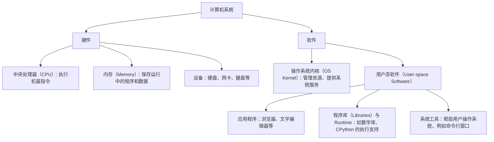

# 从计算机架构出发，理解操作系统、进程与线程

[上一篇](../01-how-python-runs/)讨论了代码怎样被转换，以及最终由谁执行。现在，我们把这些角色放回一台计算机中，先看它们各自在哪里，再看它们怎样配合。

## 1. 一台计算机，先分硬件与软件

先看普通桌面系统中，与运行程序直接相关的主要部分：



这张图的连线表示分类关系。

**CPU、内存和设备是硬件。** CPU 执行机器指令，指令可以读取或修改内存中的数据；设备则提供存储、通信和输入输出等能力。

**应用、程序库（Libraries）、语言运行时系统（Runtime System）和内核（Kernel）都是软件。** 它们的职责不同，但它们的机器指令都需要 CPU 执行。

操作系统（Operating System，OS）通常还包括用户态系统工具。下面讨论资源管理和系统服务时，主要指操作系统的**内核**。

应用与内核在硬件上的关系是：

> 应用和内核都在这台计算机上运行；内核承担管理职责，它自己的代码也由 CPU 执行。

## 2. 应用、库、Runtime 与内核，分别负责什么？

沿用上一篇的两个例子：

```bash
./demo
python3 main.py
```

执行 C 程序 `demo` 时，CPU 执行程序及其使用的运行库等机器指令。

执行 `python3 main.py` 时，启动的是 CPython。它读取并处理 Python 代码；CPU 执行的是 CPython 及其调用的原生代码的机器指令。

### Runtime 具体在做什么？

**语言运行时系统（Runtime System，后文简称 Runtime）**指程序执行过程中，为某种语言提供支持的一组软件机制和代码。这里的 Runtime 是软件支持机制，不是程序运行的那段时间；描述时间时，本文使用“执行期间”或“运行过程中”。

以 CPython 为例，它的 Runtime 支持包含解释执行字节码、处理 Python 对象与操作，以及管理对象所需的内存。把这些职责放到一个具体函数中看：

```python
def add(a, b):
    return a + b
```

调用 `add(2, 3)` 时，这里的 `+` 做整数加法；调用 `add("hello", "world")` 时，同一个 `+` 做字符串拼接。函数的源码相同，参数却可以是不同类型的对象，执行时需要按照 Python 的规则处理它们。

CPython 提供的支持具体包括：

- 处理函数调用，把传入的对象与参数对应起来，并记录函数执行的位置。
- 根据对象的类型执行相应操作，例如整数相加或字符串拼接，再把结果交还调用者。
- 组织整数、字符串等 Python 对象在内存中的表示，并管理对象的生命周期与回收。

这些工作由 CPython 中已有的支持代码完成，最终也是 CPU 执行这些代码的机器指令。[Python：对象、类型与操作](https://docs.python.org/3/reference/datamodel.html#objects-values-and-types) [Python：CPython 字节码](https://docs.python.org/3/glossary.html#term-bytecode)

Runtime 支持可以包含在解释器中，也可以以库等形式与程序一起使用；它不一定是一个单独启动的程序。

### 程序库、Runtime 与内核的职责

程序库提供可以调用的现成功能，例如排序或数学计算。Runtime 则承担执行该语言代码时需要的支持工作，例如上面 Python 函数调用、对象操作与内存管理。两者的职责可能有交集，Runtime 支持本身也可以以库的形式提供。

| 角色 | 主要负责什么 |
| --- | --- |
| 应用代码 | 描述具体任务，例如计算结果、处理文本 |
| 程序库 | 提供可复用的功能，例如排序、数学计算 |
| Runtime | 支持语言中的操作，例如 CPython 处理字节码、函数调用、Python 对象和对象内存 |
| 操作系统内核 | 管理进程可使用的内存、CPU 执行机会、文件和设备等资源，提供系统服务 |
| CPU | 执行应用、库、Runtime 或内核的机器指令 |

以内存为例，内核管理进程能够使用的内存资源；CPython 在这些内存中组织 Python 对象，并处理哪些对象还在使用、哪些可以回收。因此，“内核管理内存”和“Runtime 管理对象内存”是在不同层次上管理同一台机器中的资源。[Python：对象回收](https://docs.python.org/3/library/gc.html)

这里也能解释上一篇留下的疑问：**应用执行时，操作系统是否一直在逐条指挥 CPU？**

普通计算可以直接通过机器指令推进。需要系统服务时，执行流程才会进入内核；中断等事件也可以让 CPU 转去执行内核代码。因此，整个运行过程包含应用代码与内核代码之间的执行转换。[OSTEP：受限直接执行](https://pages.cs.wisc.edu/~remzi/OSTEP/cpu-mechanisms.pdf)

到这里，我们明确了“有哪些硬件和软件”。接下来换一个视角：这些软件真正运行起来以后，怎样组织和管理？

## 3. 进程与线程：哪些独立，哪些共享？

以一个简化的文本编辑器为例，比较两种运行结构：分别启动两个编辑器实例，让它们作为两个独立进程运行；在一个编辑器进程中，用两个线程分别处理输入和检查文档。这里讨论的是设定的结构，实际编辑器可以组合使用多个进程和多个线程。

### 两个进程：分别管理两次运行

假设两次启动使用同一份编辑器程序文件，每次都把文档读入自己的内存。程序文件相同，但两次运行的文档内容、打开的文件和执行进度需要分别管理。

```text
编辑器进程 A
├── 自己的地址空间与文档数据
└── 线程 A：自己的执行位置、寄存器状态和栈

编辑器进程 B
├── 自己的地址空间与文档数据
└── 线程 B：自己的执行位置、寄存器状态和栈
```

在 A 中输入一个字，修改的是 A 内存中的文档数据，不会自动改动 B 内存中的那一份。即使它们打开同一个磁盘文件，内存中的两份数据也不会自动保持一致；保存和重新读取文件是另外的操作。

操作系统用**进程（Process）**组织一次运行的地址空间（Address Space）、资源与相关状态。普通进程通常拥有各自的地址空间；需要交换数据时，可以使用进程间通信，也可以明确建立共享内存。[Linux：进程与地址空间](https://man7.org/linux/man-pages/man2/fork.2.html)

这里的独立主要指运行状态和地址空间的边界，并不意味着两个进程不能访问同一个文件，也不意味着它们使用的所有物理内存都必须是两份。

### 同一进程中的两个线程：共享资源，分别推进工作

现在只看其中一个编辑器。它一边响应输入，一边在后台检查文档。两项工作可以访问同一份文档对象，却需要分别记录各自正在做什么：输入处理可能正在插入字符，检查工作可能正在分析另一段文字。

**线程（Thread）**表示这样一条执行路线。同一进程中的线程共享地址空间及打开的文件等资源，各自保留执行位置、寄存器状态和栈。[Linux：线程的共享与独立属性](https://man7.org/linux/man-pages/man7/pthreads.7.html)

```text
一个编辑器进程
├── 共同访问的代码、文档数据和文件等资源
├── 输入线程：自己的执行位置、寄存器状态和栈
└── 检查线程：自己的执行位置、寄存器状态和栈
```

两个线程使用的是同一个文档对象，输入线程的修改作用于这份共同的数据。它们可以在不同的位置执行、调用不同的函数，所以仍然需要各自的执行状态和栈。各线程的栈也位于同一个进程的地址空间中，并不是各自隔离的地址空间。

### 把两种结构放在一起比较

| 比较对象 | 两个独立进程，各有一个线程 | 同一进程中的两个线程 |
| --- | --- | --- |
| 地址空间 | 通常各自拥有一个 | 共享同一个 |
| 内存中的文档数据 | 本例中各自保存一份，修改不会自动传给另一份 | 本例中共同访问同一份对象 |
| 执行位置与寄存器状态 | 各自的线程分别记录 | 两个线程分别记录 |
| 栈 | 各自线程使用各自的栈 | 各自使用各自的栈，但都在同一地址空间中 |
| 协作方式 | 通过通信，或明确建立共享内存等机制 | 可以直接访问共同数据，并协调访问时序 |

**进程确定资源与地址空间的组织边界；线程记录其中一条执行路线怎样推进。** 一个进程可以只有一个线程，也可以有多个线程。因此，“一个进程”和“一个线程”描述的是不同方面，单线程进程也同时具有这两个方面。

共享数据也让协作有了新的要求：检查线程读取文档时，输入线程可能正在修改它。程序需要安排访问时序或提供一致的数据快照，才能使检查结果对应一份确定的文档内容。

## 4. 从启动到等待输入：一段 Python 程序怎样运行？

把前面的 `add()` 放进 `main.py`，在计算之后等待一次输入，再打印结果：

```python
def add(a, b):
    return a + b

result = add(2, 3)
input("按回车继续：")
print(result)
```

在终端中启动它：

```bash
python3 main.py
```

下面以普通 Linux 环境、这个程序只有一个主线程、标准输入连接终端且暂时没有可读取的输入为例，沿着执行顺序观察各个角色。

### 启动：进程承载资源，线程开始执行 CPython

这次启动产生一个运行 CPython 的进程。内核为运行活动管理地址空间、文件等资源，并安排线程获得 CPU 的执行机会。CPython 读取 `main.py`，处理脚本中的代码。[Python：执行脚本](https://docs.python.org/3/using/cmdline.html)

这里三个概念同时存在：

- **进程**是这次运行的资源与状态组织。
- **主线程**是这次运行中推进工作的执行路线。
- **Runtime**是这条执行路线使用的软件支持；CPython 中的函数调用、对象操作等支持代码随它一起执行。

Runtime 并不是另一个替你执行程序的进程。它是当前进程中使用的软件，执行其机器指令的仍然是 CPU。

### 计算：主线程通过 Runtime 完成 Python 操作

执行 `result = add(2, 3)` 时，CPython 处理函数调用、取得参数、完成整数加法，并把结果对象与名称 `result` 关联起来。

从 Python 代码看，是执行了函数和加法；从硬件看，是 CPU 在执行 CPython 的机器指令。线程描述这条执行路线，Runtime 提供处理 Python 操作的代码。计算本身不要求内核逐条解释 Python 代码。[Python：对象与操作](https://docs.python.org/3/reference/datamodel.html#objects-values-and-types)

应用和 Runtime 的普通代码通常在**用户态（User Mode）**执行，受到硬件权限机制的限制。需要受保护的系统服务时，执行可以进入**内核态（Kernel Mode）**，由 CPU 执行内核代码。[OSTEP：执行权限](https://pages.cs.wisc.edu/~remzi/OSTEP/cpu-mechanisms.pdf)

### 请求输入：同一线程进入内核获取服务

执行到 `input()`，程序先显示提示文字，再从标准输入读取一行。[Python：input](https://docs.python.org/3/library/functions.html#input)

Python 的输入处理会使用底层输入输出功能；当需要内核提供读取服务时，发起**系统调用（System Call）**。这时 CPU 的执行流程进入内核，处理这个线程的请求。[Linux：系统调用](https://man7.org/linux/man-pages/man2/syscalls.2.html)

```text
主线程在用户态执行 CPython / Runtime 代码
                   ↓ 发起读取相关的 System Call
同一线程进入内核态，CPU 执行处理请求的内核代码
```

这里发生的是执行权限和执行代码的转换。此时仍可以是同一个线程，并没有因为进入内核就必然切换到另一个线程。[Linux 内核：执行进入与退出](https://docs.kernel.org/core-api/entry.html)

### 等待：内核安排其他线程使用 CPU

在本例设定下，终端暂时没有可读取的输入，读取需要等待。主线程进入**阻塞（Blocked）**状态：它还存在，但需要等某个事件发生才能继续。`result` 对应的对象仍保留在进程的内存中，后面的 `print(result)` 尚未执行。[OSTEP：运行与等待状态](https://pages.cs.wisc.edu/~remzi/OSTEP/cpu-intro.pdf)

内核可以从其他可以运行的线程中选择一个，让它获得 CPU。这种选择叫作**调度（Scheduling）**。在 Linux 中，被安排执行的通常是线程，而这些线程分别属于相应的进程。[Linux：调度](https://man7.org/linux/man-pages/man7/sched.7.html)

从当前线程转去执行另一个线程，还需要保存当前的执行状态，并恢复另一个线程的状态。这个动作叫作**上下文切换（Context Switch）**。原来进程中的文档、变量或对象并不需要因此全部复制一遍。

也可以在没有等待输入时发生切换。例如，如果主线程持续计算，**定时器中断（Timer Interrupt）**等机制能使 CPU 进入内核处理流程，让内核有机会决定是否安排其他线程。中断发生后也可能继续执行原线程；进入内核与切换线程仍是两件不同的事。[OSTEP：执行控制与上下文切换](https://pages.cs.wisc.edu/~remzi/OSTEP/cpu-mechanisms.pdf)

### 输入到达：重新获得执行机会，再继续 Python 代码

当终端输入可用，内核可以使等待的主线程恢复为**就绪（Ready）**：它已经可以继续，但还需要获得 CPU 的执行机会。

再次被调度后，线程恢复执行，完成输入处理并返回 Python 代码。CPython 接着处理 `print(result)`，将整数结果转换为需要输出的文本，再通过输出功能显示出来；涉及系统输出服务时，又会使用相应的系统调用。[OSTEP：从就绪到运行](https://pages.cs.wisc.edu/~remzi/OSTEP/cpu-intro.pdf) [Python：print](https://docs.python.org/3/library/functions.html#print)

这段执行中，进程一直保留自己的资源，主线程可能多次暂停和恢复。每次回到 Python 代码，CPU 继续执行 CPython 中相应的 Runtime 与库代码，从此前保存的位置推进工作。
