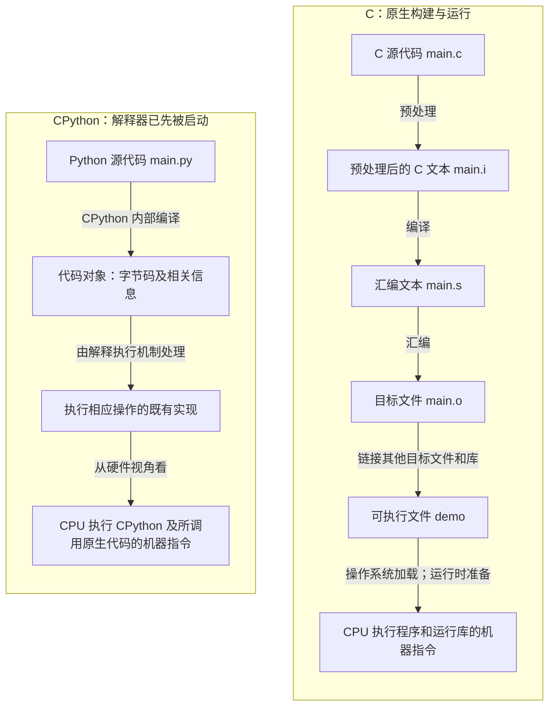

# 运行程序时，到底是谁在执行谁？

## 从 C 的编译、汇编与链接，到 CPython 的字节码解释执行

> 范围：本文讨论普通操作系统环境中的 C 原生编译流程，以及 CPython 的常规字节码解释执行路径。它不是所有语言实现的统一流程图，也不展开即时编译（JIT）、GPU 或虚拟机监控器。
>
> 版本提醒：示例的实际运行环境与结果见文末实验记录。不要把某个版本的汇编输出或 Python 字节码名称当成跨版本规范。

初学时，我最容易把两件事混起来：**代码被转换成什么形式**，以及**究竟是谁在执行这些操作**。

比如，“Python 会被编译成字节码”和“Python 由解释器执行”可以同时成立。前一句说的是转换结果，后一句说的是执行方式。只问一种语言“是编译型还是解释型”，往往会把具体实现的差别藏起来。[语言实现的整体地图][map]

本文用 C 与 Python 的小例子，把这两个问题分别讲清楚。

## 1. 先分清四种东西

| 名称 | 可以先怎样理解 | 本文中的例子 |
| --- | --- | --- |
| 源代码（source code） | 人按照某种语言的规则写下的程序文本 | `main.c`、`main.py` |
| 汇编语言（assembly language） | 用助记符、标签等表达底层操作的文本语言 | C 编译流程中的 `main.s` |
| 机器码（machine code） | 针对某种处理器指令集编码的指令 | 原生可执行程序中的指令 |
| 字节码（bytecode） | 某种软件执行引擎使用的中间指令表示 | CPython 代码对象中的字节码 |

汇编文本不是机器码，字节码也不是某个“CPU 通用指令集”。GNU 汇编器把汇编输入转换成目标文件；CPython 的字节码则属于解释器内部表示，而且可能随 Python 版本改变。[GNU 汇编器文档][as-object] [Python 术语表][glossary]

还要避免另一个误解：一个文件是二进制文件，并不意味着 CPU 就能把它当程序执行。图片、压缩包和 `.pyc` 都能以字节保存；区别在于它们遵循什么格式、由谁读取和怎样使用。

## 2. C：先构建可执行程序，再运行它

以 GCC 的常见流程为例，可以分成预处理、编译、汇编和链接。这里的“编译”有两个用法：日常说“编译项目”可能指整条构建流程；下面说“编译阶段”，则特指生成汇编的那个阶段。[GCC 手册][gcc]

### 预处理：整理编译器接下来要处理的源代码

`#include` 引入头文件内容，`#define` 定义的宏可以被展开，条件编译决定保留哪些部分。输出仍然是源代码层面的文本，而不是机器指令。[C 预处理器概述][cpp]

因此，`#include <stdio.h>` 不能简单理解成“把完整的打印功能装进程序”。头文件主要提供声明等内容，函数实现还涉及库和链接。

### 编译：把 C 程序转换为目标平台的汇编表示

在本文展示的 GCC 路径里，编译器处理 C 语言结构，并产生汇编。编译器可能优化程序，所以源代码与机器操作不是逐行一一对应关系。这里保留汇编文件，是为了观察过程，不意味着所有编译器都必须把汇编文本写到磁盘上。[GCC 手册][gcc] [语言实现的整体地图][map]

### 汇编：把汇编文本变成目标文件

汇编器生成 `.o` 目标文件，其中包含机器码，以及供后续处理使用的信息。**目标文件里已经可以有机器码，但它仍不一定是可以直接启动的完整程序。**[GNU 汇编器文档][as-object]

### 链接：连接不同文件中的定义和引用

假设 `main.c` 调用了 `add()`，而 `add()` 的实现写在 `add.c`。分别处理后，`main.o` 需要与 `add.o` 中的定义连接。链接器合并相关输入，并处理符号与地址关系，生成可执行文件。[GNU 链接器文档][ld] [中文教材：多目标文件的链接][c-link]

动态链接程序还可能依赖运行时加载的共享库。因此，“链接完成”也不等于“所有依赖代码都已复制进一个文件”。[Linux execve 手册][execve]

### 运行：此时不需要编译器逐条指挥

执行 `./demo` 时，在 Linux 上，程序加载涉及建立新的程序映像；动态链接的 ELF 程序还涉及相应的动态加载器。CPU 随后执行程序、运行库等部分的机器指令，而不是继续让 C 编译器解释 `.c` 文件。[Linux execve 手册][execve]

这里应当区分：**构建 `demo` 时，CPU 在运行编译工具；运行 `demo` 时，CPU 在运行生成的程序。**二者是不同的软件运行过程。

## 3. Python：解释器自己已经是可运行的软件

先考虑这个命令：

```bash
python3 main.py
```

`python3` 是被启动的程序；`main.py` 是交给它处理的文件。本文把这个 Python 实现限定为 CPython，而不是把所有 Python 实现混为一谈。[Python 命令行文档][cmdline] [Python 术语表][glossary]

CPython 本身包含编译与执行代码的能力。对于本文讨论的路径，它读取 Python 源代码，生成包含字节码的代码对象，再由解释执行机制处理这些指令。这里的“代码对象”可以先理解成一个容器：除字节码外，还保存执行时需要的常量、名称等信息。[Python 术语表][glossary] [Python dis 文档][dis]

“解释执行”不是说解释器坐在 CPU 外面，逐句发号施令。解释器自己就是正在运行的程序。

可以从两个视角描述同一件事：

**从 Python 程序的视角：**解释器处理字节码，完成变量操作、函数调用等要求。

**从物理 CPU 的视角：**它执行解释器及所调用原生代码的机器指令；这些机器指令读取并处理字节码这种数据。[Python 术语表][glossary] [语言实现的整体地图][map]

这也回答了“解释器由谁执行”：解释器的原生部分已经被构建成目标平台能执行的软件，并不需要再无限套一层解释器。

### 编译不等于执行，解释也不等于重新生成汇编

把 Python 源代码编译成字节码，不等于已经执行了其中的 `print()`。反过来，常规字节码解释执行，也不要求先为每条字节码生成一份新的汇编文件。[Python compile 与 exec 文档][builtins] [Python dis 文档][dis]

运行时把部分代码编译成机器码，是另一类实现策略，通常称为即时编译（JIT）。本文的对比限定了执行路径，不是在断言“Python 永远不能产生机器码”。[语言实现的整体地图][map]

## 4. 把 C 与 CPython 放在一起看

下面左侧主要表示 **C 程序的构建与启动**；右侧主要表示 **已启动的 CPython 如何处理用户代码**。两侧起点不同，这是理解它们的关键。



图中的 C 四阶段来自 GCC 的常见流程；Python 一侧依据 CPython 的字节码模型。**不要把右侧最末一条箭头读成“字节码被统一翻译成机器码”**：它是在切换观察视角。[GCC 手册][gcc] [Python 术语表][glossary]

还有一个容易漏掉的前提：构建 C 程序期间，CPU 也在工作。预处理器、编译器、汇编器和链接器并不是脱离硬件运行的。

## 5. 实验一：把 C 的四个阶段分别保存下来

配套文件位于 [`examples/program-execution/`](../examples/program-execution/)。以下命令以 Linux、GCC 与 GNU 工具为例；其他平台的文件格式、工具输出和名称可能不同。

`main.c`：

```c
#include <stdio.h>

int add(int a, int b);

int main(void) {
    printf("%d\n", add(2, 3));
    return 0;
}
```

`add.c`：

```c
int add(int a, int b) {
    return a + b;
}
```

从仓库根目录执行：

```bash
cd examples/program-execution

# 只做预处理，留下文本文件。
gcc -E main.c -o main.i

# 从预处理结果生成汇编；暂时关闭优化，便于观察。
gcc -S -O0 main.i -o main.s

# 把汇编变成目标文件。
gcc -c main.s -o main.o

# 为另一个源文件生成目标文件。
gcc -c -O0 add.c -o add.o

# 链接，再运行。
gcc main.o add.o -o demo
./demo
```

输出应为 `5`。`-E` 表示停在预处理之后，`-S` 表示停在编译生成汇编之后，`-c` 表示生成目标文件而不链接。注意，`gcc -c add.c` 仍可能包含前面的预处理与编译步骤，不是“任何时候都只做汇编”。[GCC 手册][gcc]

再运行：

```bash
file main.i main.s main.o demo
nm main.o
nm add.o
objdump -d add.o
```

观察文本与目标文件的区别，以及 `main.o` 如何引用 `add`、`add.o` 如何提供它。`objdump -d` 展示的是目标文件机器码的反汇编，而不是 Python 字节码。

最后故意不链接 `add.o`：

```bash
gcc main.o -o missing-add
```

在本实验环境中，这一步链接失败，错误包含对 `add` 的未定义引用。它说明 **“源文件能分别编译”不代表“整个程序能成功链接”**。具体原始输出见[实验记录](../examples/program-execution/VERIFICATION.md)。

## 6. 实验二：把 Python 的编译和执行分开

把下面内容保存为 `inspect_python.py`：

```python
import dis

source = """
def add(a, b):
    return a + b

print(add(2, 3))
"""

print("1. 开始编译")
code = compile(source, "<example>", "exec")
print("2. 编译结束；source 内的 print 尚未执行")

print("3. 查看字节码")
dis.dis(code)

print("4. 开始执行 source")
exec(code, {})
```

运行：

```bash
python3 inspect_python.py
```

`compile()` 返回代码对象；参数中的 `"exec"` 表示输入是一组语句，而不是要求 `compile()` 当场执行它们。只有后面的 `exec()` 才执行这份代码。[Python compile 与 exec 文档][builtins]

`dis.dis()` 是查看 Python 字节码的工具，不是查看 CPU 汇编的工具。字节码格式和指令可能随版本变化，因此重点看“加载参数、加法、返回、调用”这样的操作，不要背一份固定输出。[Python dis 文档][dis]

配套测试另外捕获标准输出，确认单独编译这段 `source` 没有输出，执行后才得到 `5\n`。完整字节码展示与测试结果放在[实验记录](../examples/program-execution/VERIFICATION.md)。

### 没有 `.pyc`，是不是没有编译？

不是。生成代码对象与把缓存写到磁盘是两回事。Python 导入模块时通常可以利用 `__pycache__` 中的编译缓存；直接从命令行运行的主脚本不会按同样方式保存自己的缓存。不要只看文件夹里有没有 `.pyc`，就判断本次是否经历了字节码编译。[Python 模块教程][modules]

## 7. 几个现在应该能够回答的问题

**“编译”和“汇编”不一样，为什么又把汇编放进编译流程？**

因为“编译流程”常被用作整条构建链的总称；细分阶段时，编译与汇编是不同的转换步骤。[GCC 手册][gcc]

**Python 有编译步骤，为什么仍然讨论解释器？**

因为“生成字节码”和“执行字节码”是两件事。编译结果不必是物理 CPU 的机器码。[Python 术语表][glossary]

**既然最后都是 CPU 执行，C 和 Python 还有什么不同？**

硬件执行机器指令，并不意味着上面的软件工作相同。本文的 C 路径提前生成原生程序；CPython 路径还通过语言运行时处理字节码及 Python 对象语义。仅凭这张图不能推出任意两个完整程序的性能排名。[语言实现的整体地图][map]

**解释器和操作系统是一回事吗？**

不是。解释器实现语言的执行机制；内核提供系统服务与资源管理。它们是不同的软件角色。[Python 命令行文档][cmdline] [Linux 系统调用手册][syscalls]

## 8. 下一步需要补哪些知识？

这篇文章只回答“程序如何开始运行”的一部分。接下来可以按问题补充，而不用先制定固定周数。

| 想回答的问题 | 对应知识 |
| --- | --- |
| 一个数、字符或指针在内存里怎样表示？ | 数据表示、地址、指针、数组布局 |
| CPU 为什么会慢在访问内存，而不是计算？ | 指令执行、缓存、内存层次、局部性 |
| 同一个程序运行两次，为什么不会直接共用所有变量？ | 进程、虚拟地址空间、内存保护 |
| 两个任务同时修改数据会怎样？ | 线程、并发、同步、竞态条件 |
| 函数调用为何能跨源文件、跨库？ | 目标文件、符号、链接、加载、调用约定 |
| Python 的变量、函数和对象由谁管理？ | 语言运行时、对象模型、字节码、内存管理 |

上表是本文建议的知识组织方式，不是完整 CS 本科课程标准，也不代表这些内容已经掌握。

## 9. 参考资料与阅读顺序

以下正文链接指向原作者或项目维护的材料；本文不是对它们的逐段翻译。

先读 [Ned Batchelder：Is Python interpreted or compiled? Yes.][ned]，纠正“编译与解释互斥”的直觉。接着读 [Crafting Interpreters：A Map of the Territory][map] 的编译器与解释器部分，建立分类地图。

C 侧可读[《Linux C 编程一站式学习》：多目标文件的链接][c-link]；示例较旧，理解机制时不要把其中的地址和平台输出照搬到本机。

查具体行为时，优先回到 [GCC 选项手册][gcc]、[C 预处理器文档][cpp]、[GNU 汇编器文档][as-object]、[GNU 链接器文档][ld]、[Python 术语表][glossary]、[`compile()` / `exec()`][builtins]、[`dis`][dis] 和[模块编译缓存说明][modules]。

操作系统侧的事实入口是 [Linux `execve(2)`][execve] 与[系统调用概览][syscalls]；它们适合查证，不一定适合作为零基础教材从头读。

---

**本文最重要的区别：代码的表示形式、代码的转换过程、软件的运行职责，是三个相关但不同的问题。**

[map]: https://mail.craftinginterpreters.com/a-map-of-the-territory.html
[gcc]: https://gcc.gnu.org/onlinedocs/gcc/Overall-Options.html
[cpp]: https://gcc.gnu.org/onlinedocs/cpp/Overview.html
[as-object]: https://sourceware.org/binutils/docs/as/Object.html
[ld]: https://sourceware.org/binutils/docs/ld/Overview.html
[glossary]: https://docs.python.org/3/glossary.html#term-bytecode
[cmdline]: https://docs.python.org/3/using/cmdline.html
[builtins]: https://docs.python.org/3/library/functions.html#compile
[dis]: https://docs.python.org/3/library/dis.html
[modules]: https://docs.python.org/3/tutorial/modules.html#compiled-python-files
[execve]: https://man7.org/linux/man-pages/man2/execve.2.html
[syscalls]: https://man7.org/linux/man-pages/man2/syscalls.2.html
[c-link]: https://akaedu.github.io/book/ch20s01.html
[ned]: https://nedbatchelder.com/blog/201803/is_python_interpreted_or_compiled_yes.html
